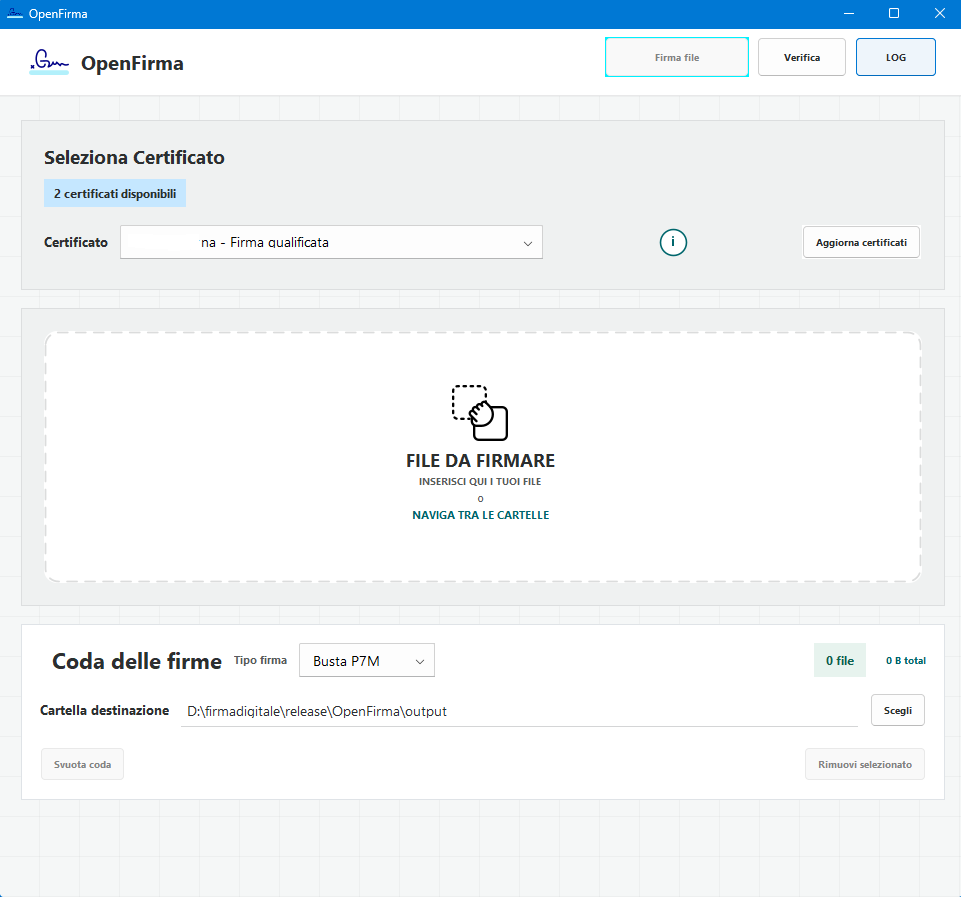

# OpenFirma

<p align="center">
  
</p>

Applicazione desktop Windows per firma digitale e verifica documenti, con supporto a:

- firma in busta `P7M`
- firma `PDF` con firma grafica visibile
- firma grafica automatica su ogni pagina del PDF
- verifica dei file firmati
- apertura del documento firmato o del contenuto verificato

## Schermata iniziale



## Funzionalita complete

### Firma P7M

- firma CMS allegata con estensione `.p7m`
- supporto multi-file
- verifica locale automatica al termine della firma
- gestione conflitti nella cartella di destinazione

### Firma PDF

- viewer PDF integrato nel popup di firma
- selezione documenti tramite tab
- zoom `+` e `-`
- pulsante `Adatta larghezza`
- posizionamento grafico della firma con drag del riquadro
- cambio pagina del PDF
- reset della posizione della firma

### Firma multipagina automatica

- opzione `Firma su ogni pagina`
- la firma grafica viene replicata su tutte le pagine del PDF nello stesso punto relativo scelto dall'utente

### Verifica file firmati

- verifica sia di file `P7M` sia di file `PDF`
- supporto multi-file
- risultati organizzati in schede
- elenco firmatari
- data creazione
- data firma
- metadati del documento verificato

### Apertura di file firmati

- pulsante `Visualizza documento` nel popup finale di verifica
- apertura del contenuto con l'applicazione predefinita del sistema

### Gestione conflitti output

Se il file di destinazione esiste gia, OpenFirma propone:

- `SOVRASCRIVI`
- `ANNULLA`
- `VERIFICA FILE`
- `RINOMINA`

Il flusso `VERIFICA FILE` permette di ispezionare il file gia presente in output prima di decidere come procedere.

### Log applicativi

- pulsante `LOG` in testata
- popup dedicato con il riepilogo operativo della sessione

## Versione Windows gia avviabile

Nel repository e inclusa anche la versione Windows gia pronta in:

```text
release/OpenFirma/
```

Eseguibile principale:

```text
release/OpenFirma/OpenFirma.exe
```

Questa versione e gia avviabile su Windows e include il runtime Java necessario.

### Come usarla correttamente su un PC Windows

1. Copia l'intera cartella `release/OpenFirma` sul PC di destinazione.
2. Non copiare solo `OpenFirma.exe`: servono anche le sottocartelle `app` e `runtime`.
3. Installa l'eventuale middleware del token o della smart card.
4. Verifica che il certificato sia visibile nello store `Windows-MY`.
5. Avvia `OpenFirma.exe`.

### Requisiti per la versione gia pronta

- Windows
- certificato di firma disponibile in `Windows-MY` oppure dispositivo correttamente esposto al sistema
- middleware del token installato, se richiesto

Per la sola versione in `release/OpenFirma` non e necessario installare Java separatamente, perche il runtime e gia incluso.

## Flussi operativi GUI

### 1. Firma in busta P7M

1. Avvia OpenFirma.
2. Seleziona il certificato nel blocco `Seleziona Certificato`.
3. Carica uno o piu file in `FILE DA FIRMARE`.
4. Controlla `Cartella destinazione`.
5. In `Tipo firma` scegli `Busta P7M`.
6. Premi `Firma file`.
7. Gestisci eventuali conflitti di output.
8. Attendi il completamento della firma.

### 2. Firma PDF con firma grafica

1. Avvia OpenFirma.
2. Seleziona il certificato.
3. Carica uno o piu PDF.
4. In `Tipo firma` scegli `PDF`.
5. Premi `Firma file`.
6. Nel popup usa le tab per passare da un documento all'altro.
7. Regola la preview con zoom o `Adatta larghezza`.
8. Posiziona il riquadro firma.
9. Se necessario attiva `Firma su ogni pagina`.
10. Premi `Avvia firma`.

### 3. Verifica di file firmati

1. Premi `Verifica`.
2. Carica uno o piu file firmati con drag-and-drop o selezione manuale.
3. Premi `Verifica`.
4. Consulta i risultati nelle schede finali.
5. Usa `Visualizza documento` se vuoi aprire il contenuto.

### 4. Consultazione log

1. Premi `LOG`.
2. Leggi il tracciamento operativo della sessione.

## Build da sorgente

Compila senza avviare la GUI:

```powershell
.\build.ps1 -BuildOnly
```

Compila e avvia la GUI:

```powershell
.\build.ps1
```

Avvia usando la build locale:

```powershell
.\run.ps1
```

## Packaging Windows

Rigenera la distribuzione Windows:

```powershell
.\package.ps1
```

Rigenerazione pulita:

```powershell
.\package.ps1 -Clean
```

Output atteso:

```text
release\OpenFirma\OpenFirma.exe
```

## Versione portable in file singolo

Genera un eseguibile autoestraente nella cartella principale:

```powershell
.\portable.ps1 -Clean
```

Output atteso:

```text
OpenFirma-Portable.exe
```

Questo file contiene la distribuzione `release\OpenFirma` con runtime Java e dipendenze. All'avvio estrae i file in una cache temporanea dell'utente e avvia OpenFirma senza installazione.

## Uso CLI tecnico

La CLI resta utile per test e automazione del backend.

Mostra help:

```powershell
java --add-modules jdk.crypto.cryptoki,jdk.crypto.mscapi -cp "out;lib\*" it.firmadigitale.AppLauncher --help
```

Elenca identita da archivio `PKCS12`:

```powershell
java --add-modules jdk.crypto.cryptoki,jdk.crypto.mscapi -cp "out;lib\*" it.firmadigitale.AppLauncher --mode PKCS12 --resource ".\testdata\signer.p12" --secret "changeit" --list
```

Firma di test `P7M`:

```powershell
java --add-modules jdk.crypto.cryptoki,jdk.crypto.mscapi -cp "out;lib\*" it.firmadigitale.AppLauncher --mode PKCS12 --resource ".\testdata\signer.p12" --secret "changeit" --out ".\output" --file ".\testdata\sample.txt"
```

## Struttura progetto

```text
design/icon/                         asset SVG della UI
mockup/                              riferimenti di design
release/OpenFirma/                   build Windows pronta all'uso
screen/                              screenshot documentazione
src/main/java/it/firmadigitale/      sorgenti Java
build.ps1                            build locale
package.ps1                          packaging Windows
run.ps1                              avvio applicazione
LICENSE                              licenza MIT
README.md                            documentazione progetto
```

## Note tecniche

- la GUI principale usa lo store `Windows-MY`
- il backend supporta anche `PKCS12` e `PKCS11`
- la modalita `PDF` usa firma visibile con preview integrata
- la verifica supporta sia `P7M` sia `PDF`
- il repository include anche una release Windows gia pronta

## Licenza

Questo progetto e rilasciato come software open source sotto licenza `MIT`.
